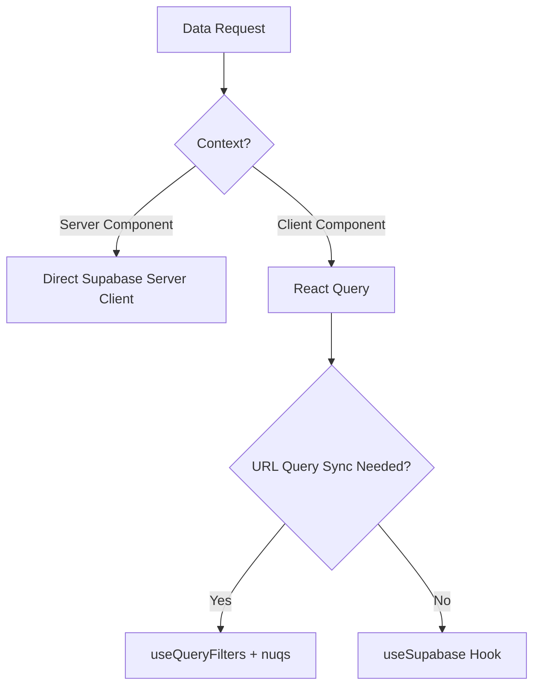

# Architecture Guide

This document describes the application architecture of Abzar Kankor, detailing the Next.js setup, Client/Server boundaries, data flow, and state management strategies.

---

## 1. Next.js App Router & Localization

The codebase uses Next.js with App Router. The entire router is nested under `src/app/[locale]/` for multi-locale localization (English, Dari/Farsi, and Pashto).

### Key Rules:
- Dynamic route parameters and localization prefixes are processed in the `[locale]` layout and page structure.
- Navigation utilizes localized routing utilities (`Link`, `useRouter` imported from `@/i18n/navigation` rather than `next/navigation`).

---

## 2. Server vs. Client Boundaries

We enforce a **Server-First** approach to data loading and page structure.

### Server Components
- **Usage**: Used for layout definitions, initial page rendering, page-level data loading, and static pages.
- **Benefits**: Reduced client-side JavaScript, direct database communication, secure execution (secrets, DB calls).
- **Rule**: Keep Server Components simple. Fetch the data, then pass it as props to feature components. Avoid importing interactivity (e.g., hooks, click listeners) directly into Server Components.

### Client Components
- **Usage**: Used only when interactive features (e.g., local state, forms, drag-and-drop, animations, browser-only APIs) are required. Mark files with `"use client"` at the top.
- **Boundary**: Keep client components as low in the tree as possible to preserve Server Component rendering for the surrounding page.

---

## 3. Data Fetching Architecture

There are two primary paradigms for fetching data in this project:

### 1. Server-Side Fetching
- For initial data loads in layouts or pages, use the Supabase server client.
- Fetches are executed directly inside async Server Components.

### 2. Client-Side Fetching
Client-side fetches are strictly managed through **TanStack Query (React Query)** to ensure caching, loading states, retry logic, and optimistic updates.
- **For simple fetches**: Use the generic `useSupabase` wrapper hook.
- **For complex lists, tables, search, filters**: Use the `useQueryFilters` hook, which automatically serializes/deserializes filter, sorting, and pagination parameters to/from the URL query parameters using `nuqs`.

---

## 4. State Management Taxonomy

Choose the narrowest state scope possible:

| State Type | Technology | Use Case | Rules |
| :--- | :--- | :--- | :--- |
| **Local UI State** | React `useState` / `useReducer` | Form field focus, local dialog open/close states, input values, toggle switches. | Never lift to global state if scoped to a single component. |
| **Shared Client State** | [Jotai](https://jotai.org/) | Global sidebar state, dark mode preference, client-only session indicators, user interface settings. | **Never** copy database records or lists into Jotai atoms. Use React Query cache instead. |
| **Server Cache** | [React Query](https://tanstack.com/query/latest) | Course contents, user course lists, flashcard deck data, test scores. | Invalidate queries instead of manually mutating local state when a database change occurs. |
